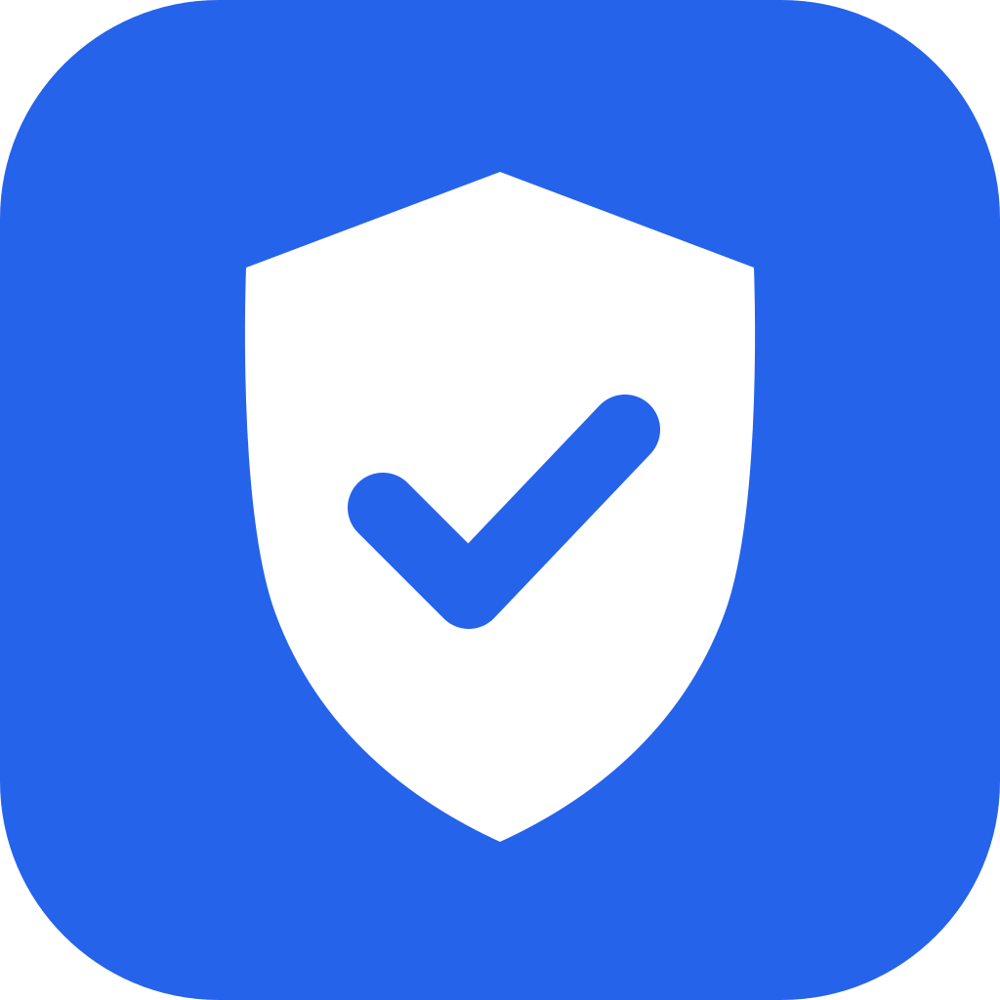
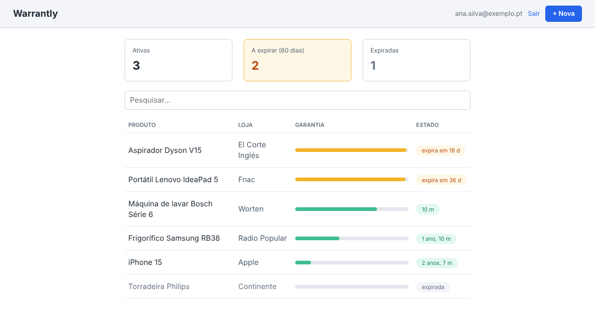
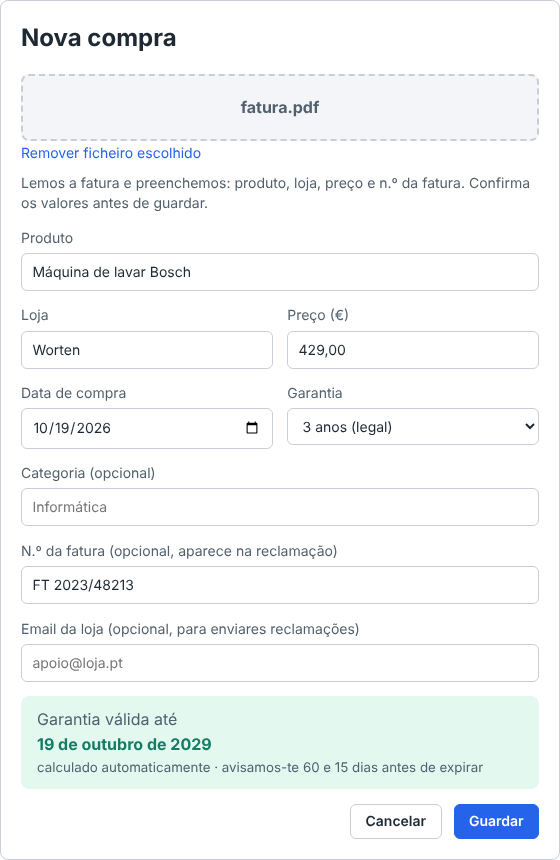
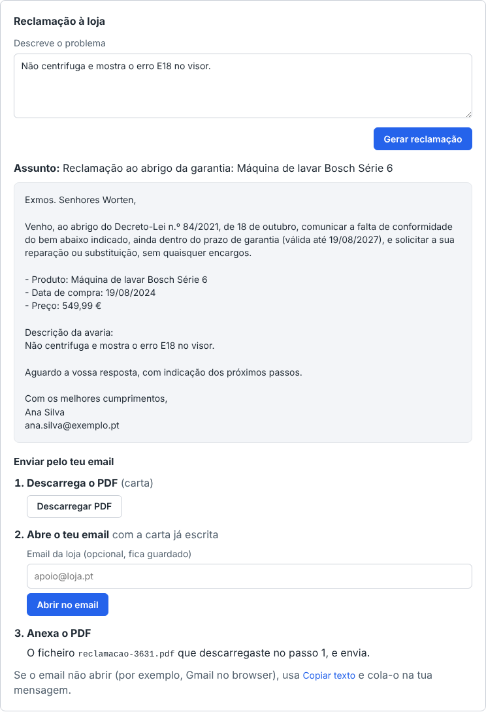
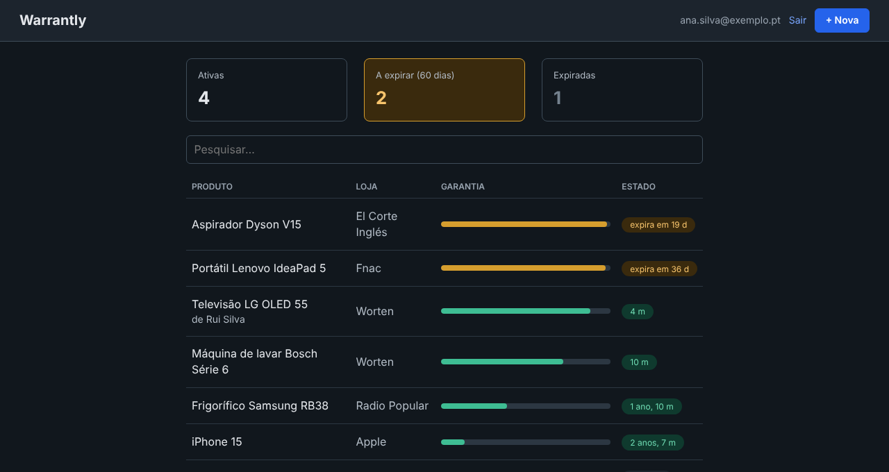
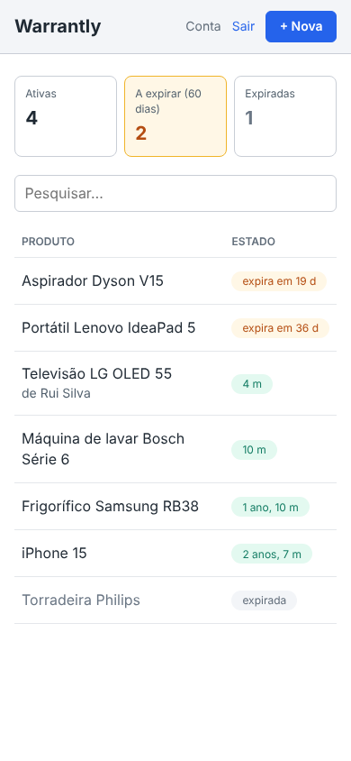
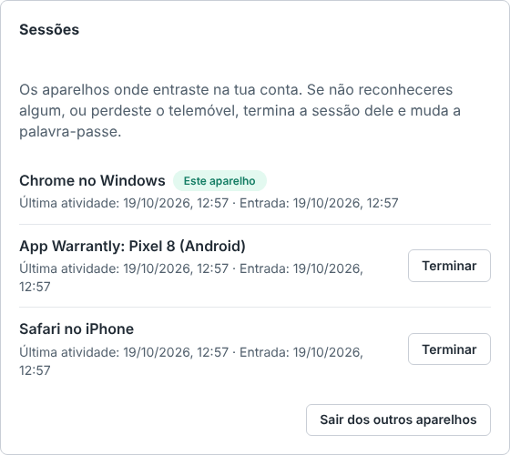
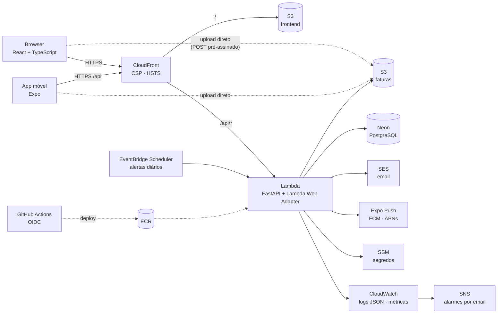

#  Warrantly

**Arquivo de garantias:** guarda as faturas das tuas compras, calcula até quando cada uma está na garantia, avisa-te antes de expirar e, quando algo avaria, escreve a reclamação para a loja.

Site (React), app móvel (Expo) e API (FastAPI + PostgreSQL), com infraestrutura na AWS em Terraform, CI/CD no GitHub Actions e cerca de 440 testes automáticos.

[](https://github.com/JoseFerrao20/warrantly/actions/workflows/backend.yml)
[](https://github.com/JoseFerrao20/warrantly/actions/workflows/frontend.yml)
[](https://github.com/JoseFerrao20/warrantly/actions/workflows/mobile.yml)
[](https://github.com/JoseFerrao20/warrantly/actions/workflows/e2e.yml)
[](https://github.com/JoseFerrao20/warrantly/actions/workflows/docker.yml)
[](https://github.com/JoseFerrao20/warrantly/actions/workflows/security.yml)

> **Estado:** a app está completa e testada no CI. O deploy na AWS está todo descrito em Terraform e é o próximo passo ([`docs/cloud.md`](docs/cloud.md)).



| Registar uma compra: a fatura é lida e os campos preenchidos | Reclamação à loja, pronta a enviar |
| --- | --- |
|  |  |

| Modo escuro | No telemóvel |
| --- | --- |
|  |  |

| Sessões na conta: terminar a de um telemóvel perdido |
| --- |
|  |

## O problema

Em Portugal, os bens novos têm 3 anos de garantia legal (Decreto-Lei n.º 84/2021). Mas quando a máquina de lavar avaria ao fim de dois anos e meio, ninguém sabe onde está a fatura nem quando foi a compra, e muito menos o que escrever à loja. A garantia existe, mas acaba por não ser usada.

## O que a app faz

- **Registar compras com a fatura.** Carregas um PDF ou uma fotografia, e a app lê-a e sugere o produto, a loja, a data, o preço e o n.º da fatura. Confirmas antes de guardar.
- **Calcular o prazo.** São 3 anos por omissão, ajustáveis para garantias de marca ou bens usados.
- **Painel.** As garantias aparecem pela ordem em que acabam, com o estado de cada uma. Tem pesquisa e filtros.
- **Alertas.** Recebes um email e uma notificação na app móvel 60 e 15 dias antes do fim.
- **Reclamação pronta.** A carta já vem preenchida com os dados da compra e a descrição da avaria, em PDF com a fatura anexada. Abre no teu email com tudo escrito.
- **Exportar.** Um ZIP com todas as compras (CSV para o Excel e JSON) e as faturas.
- **Conta.** Recuperação da palavra-passe por email, sessões longas, a lista dos aparelhos com sessão aberta (para terminar a de um telemóvel perdido) e apagar a conta com todos os dados.
- **App móvel** (Android e iOS). Vês as garantias e registas uma compra fotografando a fatura na loja.

## Arquitetura

Serverless na AWS, pensada para custar **0 €** num projeto sem utilizadores ([ADR 0002](docs/adr/0002-arquitetura-serverless.md)).



- **A mesma imagem Docker** corre no CI, no contentor de produção e no Lambda, com o [Lambda Web Adapter](https://github.com/awslabs/aws-lambda-web-adapter). Esse adaptador também entrega os eventos agendados à app.
- **As faturas não passam pelo Lambda.** O browser e o telemóvel enviam-nas diretamente para o S3 com um POST pré-assinado, porque o Lambda limita cada pedido a 6 MB.
- **A infraestrutura é toda Terraform** (`infra/`). O GitHub Actions entra na AWS por OIDC, sem chaves guardadas no repositório.

## Stack

| | |
| --- | --- |
| **Backend** | Python 3.12, FastAPI, SQLAlchemy 2, Alembic, PostgreSQL 16, Pydantic, Tesseract (OCR), ReportLab e pypdf (PDF) |
| **Frontend** | React 19, TypeScript, Vite, React Router, CSS próprio com modo claro e escuro |
| **App móvel** | Expo SDK 58 (React Native), Expo Router, expo-secure-store, expo-notifications |
| **Cloud** | AWS: Lambda, S3, CloudFront, SES, SSM, EventBridge Scheduler, CloudWatch, SNS, ECR, IAM. Neon (PostgreSQL) |
| **Infraestrutura e entrega** | Terraform, Docker, GitHub Actions (CI, deploy com OIDC), Dependabot |
| **Testes** | pytest, moto, Vitest, Testing Library, jest-expo, Playwright, axe |
| **Ambiente** | Dev container e GitHub Codespaces, com Postgres, Mailpit, AWS CLI e Terraform |

## Destaques técnicos

- **Leitura das faturas.**
  - Os PDF com texto são lidos diretamente; as fotografias passam por OCR com o Tesseract, no próprio servidor.
  - A app sugere os campos e preenche só os que estão vazios: a pessoa confirma sempre.
  - O tipo do ficheiro é reconhecido pelos bytes, não pelo nome, e as fotografias HEIC do iPhone são convertidas para JPEG.
- **Sessões seguras.** O token de acesso dura 15 minutos e o refresh token **muda a cada uso**: se um já usado voltar a aparecer, a sessão desse aparelho é revogada. Na conta, a lista de sessões deixa terminar a de outro aparelho, e o corte é imediato: o token de acesso leva o id da sessão. No browser, o refresh token vai num cookie `HttpOnly` e `SameSite=Strict`, e o token de acesso só existe em memória (nunca no `localStorage`); na app, no armazenamento seguro do telemóvel ([ADR 0004](docs/adr/0004-sessoes-com-refresh-token.md)).
- **Recuperar a palavra-passe sem guardar tokens.**
  - O link leva um JWT com uma impressão do hash da palavra-passe, por isso deixa de servir assim que a palavra-passe muda.
  - O token vai no fragmento do URL, que nunca chega aos logs do servidor.
  - A resposta é a mesma exista ou não a conta, para não revelar que emails estão registados.
- **Partilha com a família.** O arquivo partilha-se por convite, e quem aceita vê as compras, edita-as e reclama à loja. Apagar e trocar a fatura ficam com quem registou a compra. O convite é para o email, e a resposta é a mesma com ou sem conta, por isso não revela quem usa a app ([ADR 0007](docs/adr/0007-partilha-do-arquivo.md)).
- **Alertas com push** pelo serviço do Expo ([ADR 0003](docs/adr/0003-notificacoes-push-pelo-expo.md)), agendados no EventBridge Scheduler com o fuso horário de Lisboa ([ADR 0006](docs/adr/0006-alertas-com-eventbridge-scheduler.md)). Meia hora depois, outro agendamento lê os recibos de entrega e apaga os tokens das apps desinstaladas.
- **Observabilidade.**
  - Logs em JSON com um `request_id` por pedido.
  - Métricas de negócio pelo Embedded Metric Format, sem chamadas extra à API do CloudWatch.
  - 7 alarmes por email e um dashboard, tudo no nível gratuito.
  - Um dos alarmes avisa quando os alertas diários *deixam* de correr ([ADR 0005](docs/adr/0005-observabilidade.md)).
- **Acessibilidade WCAG 2.2 AA.** O axe corre nos testes E2E em todas as páginas, nos dois temas e a 320 px de largura, e há um teste de navegação só com o teclado.

## Qualidade

| | Testes | No CI |
| --- | --- | --- |
| Backend | 290 (pytest, com Postgres; S3, SSM e SES simulados com o moto) | ruff (lint, formatação e regras de segurança do Bandit) |
| Frontend | 92 (Vitest e Testing Library) | oxlint, TypeScript, build |
| App móvel | 61 (jest-expo e Testing Library) | ESLint, TypeScript, bundle de Android |
| De ponta a ponta | 25 (Playwright no Chromium, incluindo o axe e um email de recuperação lido do disco) | contra o Vite e contra o contentor de produção |
| Infraestrutura | — | `terraform validate` e, com a AWS configurada, o `plan` em cada PR |
| App publicada | 26 verificações (`scripts/smoke_test.py`: cabeçalhos, rotas fechadas, cookie da sessão, limite de tentativas) | no fim de cada deploy e contra o contentor de produção |

Cada alteração entra por um PR com o CI verde. As decisões ficam em [`docs/adr/`](docs/adr/), e o histórico, com o que correu mal e o que aprendi, no [`DEVLOG.md`](DEVLOG.md).

## Segurança

- **Palavras-passe:** Argon2. No login com um email que não existe, a resposta demora o mesmo, para não revelar que emails estão registados.
- **Limite de tentativas** no login, no registo, na recuperação da palavra-passe e ao apagar a conta. Depois do limite, a resposta é 429 com `Retry-After`. A contagem fica no Postgres, para valer para todas as instâncias do Lambda, e guarda só um HMAC da chave, sem emails nem IPs.
- **Pedidos e ficheiros:**
  - pedidos acima de 11 MB são cortados (413), mesmo sem `Content-Length`;
  - as faturas são validadas pelos bytes e guardadas com nomes aleatórios.
- **Cabeçalhos:** CSP sem scripts inline, `frame-ancestors 'none'`, HSTS com `preload`, `Referrer-Policy: no-referrer` e `Permissions-Policy`. Em produção não existem `/docs` nem `/openapi.json`.
- **No CI** (`security.yml`, em cada PR e todas as semanas):
  - `pip-audit` e `npm audit` nas dependências;
  - **Checkov** no Terraform, no Dockerfile e nos workflows, com cada exceção aceite justificada no [`.checkov.yaml`](.checkov.yaml);
  - **Dependabot** com atualizações semanais agrupadas;
  - **CodeQL** pronto para quando o repositório for público.
- **Na AWS:**
  - papéis IAM com o mínimo de permissões e deploy por OIDC só a partir do `main`;
  - segredos no SSM, cifrados;
  - buckets privados (o frontend só é lido pelo CloudFront);
  - imagens imutáveis no ECR.

## Estrutura

```
backend/    API FastAPI, modelos, migrações Alembic e testes
frontend/   site em React (Vite) e testes E2E (Playwright)
mobile/     app Expo (Android e iOS)
scripts/    verificações rápidas de uma app publicada (smoke test)
infra/      Terraform: bootstrap (estado, OIDC, orçamento) e app (Lambda, S3, CloudFront, …)
docs/       ADR, guia da cloud, push, desenvolvimento e capturas de ecrã
```

## Correr localmente

O ambiente está no dev container (`.devcontainer/`): abre o repositório no VS Code com **Reopen in Container**, ou num Codespace.

```bash
cd backend && alembic upgrade head && uvicorn app.main:app --reload   # API em :8000
cd frontend && npm run dev                                              # site em :5173
```

O resto está documentado à parte:
- [`docs/desenvolvimento.md`](docs/desenvolvimento.md): todas as rotas da API, testes, E2E e a app móvel;
- [`docs/cloud.md`](docs/cloud.md): o primeiro deploy na AWS, passo a passo;
- [`docs/push.md`](docs/push.md): notificações num telemóvel a sério.

## Decisões

| ADR | Decisão |
| --- | --- |
| [0001](docs/adr/0001-aws-em-vez-de-fly.md) | AWS em vez do Fly.io, para aprender a cloud mais pedida |
| [0002](docs/adr/0002-arquitetura-serverless.md) | Serverless (Lambda, S3, CloudFront e Neon) para custar 0 € nesta fase |
| [0003](docs/adr/0003-notificacoes-push-pelo-expo.md) | Notificações push pelo serviço do Expo |
| [0004](docs/adr/0004-sessoes-com-refresh-token.md) | Sessões longas com refresh tokens e rotação |
| [0005](docs/adr/0005-observabilidade.md) | Logs JSON, métricas EMF e alarmes no CloudWatch |
| [0006](docs/adr/0006-alertas-com-eventbridge-scheduler.md) | Alertas diários com o EventBridge Scheduler |
| [0007](docs/adr/0007-partilha-do-arquivo.md) | Partilha do arquivo de garantias com a família |

## O que aprendi

- **Cloud com orçamento zero.** Comparar arquiteturas pelo que custam paradas: um balanceador, um NAT ou um RDS cobram mesmo sem utilizadores. Também aprendi a contornar os limites do Lambda (o upload direto para o S3, por exemplo) e a escrever tudo em Terraform com permissões mínimas.
- **Segurança como hábito.** Nem sempre o mais seguro é o mais complicado: o token de recuperação sem tabela, o cookie `HttpOnly` e respostas que não revelam que emails existem. Cada exceção de segurança aceite fica escrita, com a razão.
- **Testes a vários níveis.** Testes unitários com a AWS simulada, testes de componentes e E2E que seguem um email a sério ou correm contra a imagem de produção. Um teste que falha só quando corre com os outros tem quase sempre um estado partilhado por trás.
- **Produto.** A leitura da fatura só *sugere*, porque na dúvida é melhor não preencher do que preencher mal. A reclamação é enviada pelo email da própria pessoa, que é o que a loja leva a sério.
- **Processo.** PRs pequenos com o CI verde, uma decisão por ADR e um DEVLOG honesto, com o que falhou e porquê.

O Warrantly foi feito por José Ferrão em sessões com o [Claude Code](https://claude.com/claude-code) como assistente de programação. As decisões, a revisão e os merges foram meus, e o processo está registado no [`DEVLOG.md`](DEVLOG.md).
