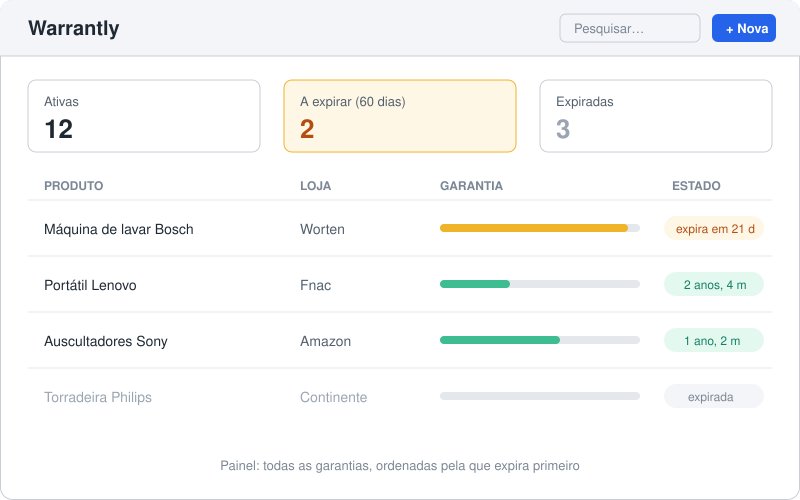
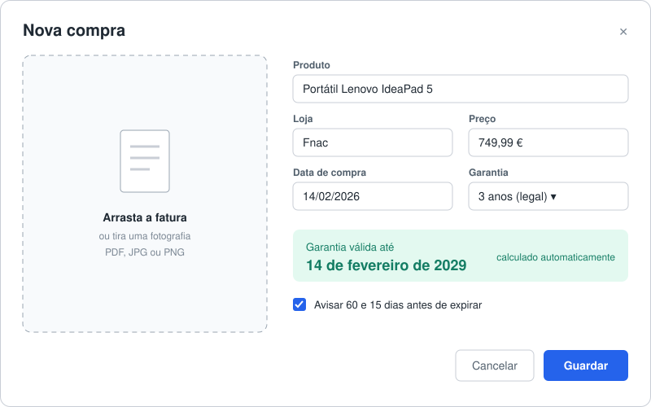
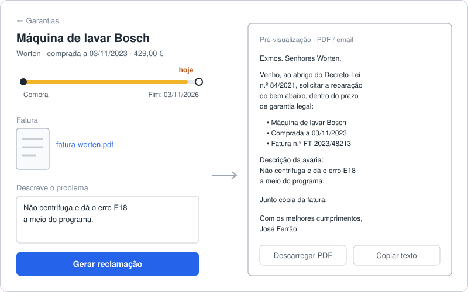

# Warrantly

Arquivo de garantias: guarda as faturas das tuas compras, acompanha o prazo de garantia de cada uma e avisa-te antes de expirarem. Quando algo avaria, gera a reclamação para a loja já preenchida.

> Estado: em desenvolvimento (projeto de aprendizagem full stack, 12 semanas).

## O problema

Em Portugal, os bens novos têm 3 anos de garantia legal (Decreto-Lei n.º 84/2021). Na prática, quando a máquina de lavar avaria ao fim de dois anos e meio, ninguém sabe onde está a fatura, quando foi a compra, nem o que escrever à loja. A garantia existe, mas acaba por não ser usada.

## O que a app faz

- **Registar compras:** carregas a fatura (PDF ou fotografia) e a app lê-a e sugere o produto, a loja, a data, o preço e o n.º da fatura (PDF com texto diretamente; fotografias com OCR, pelo Tesseract, sem sair do servidor). Confirmas e corriges antes de guardar.
- **Calcular o prazo:** a data de fim da garantia é calculada automaticamente (3 anos por omissão, ajustável para garantias de marca ou bens usados).
- **Painel:** todas as garantias ordenadas pela que expira primeiro, com o estado de cada uma (ativa, a expirar, expirada).
- **Alertas:** aviso por email (e notificação na app móvel) 60 e 15 dias antes de cada garantia expirar.
- **Reclamação pronta:** a partir de uma compra e de uma descrição da avaria, gera o texto da reclamação para a loja, com os dados da compra e a fatura em anexo.
- **Pesquisa e filtros:** por loja, categoria e estado.
- **Exportar:** um ZIP com todas as compras (CSV para o Excel e JSON) e as faturas.
- **App móvel:** Android e iOS (Expo), para ver as garantias e registar uma compra fotografando a fatura na loja.

Ideias para depois: partilhar o arquivo com a família.

## Sketches

**Painel**



**Nova compra**



**Gerar reclamação**



## Stack prevista

- **Frontend:** React com TypeScript
- **App móvel:** Expo (React Native) com TypeScript
- **Backend:** Python (API REST) com PostgreSQL e migrações Alembic
- **Testes:** pytest, testes de componentes e Playwright (E2E)
- **Ambiente:** dev container (VS Code no desktop, GitHub Codespaces no portátil)
- **Entrega:** CI no GitHub Actions, Docker e deploy

## Desenvolvimento

O ambiente fica definido em `.devcontainer/`: Python 3.12, Node 22 e PostgreSQL 16 (num contentor à parte).

1. Abre o repositório no VS Code com a extensão Dev Containers e escolhe **Reopen in Container**, ou cria um Codespace.
2. No primeiro arranque, o `.env` é criado a partir de `.env.example`.
3. A base de dados fica disponível em `db:5432` (utilizador, palavra-passe e base de dados: `warrantly`).

### Backend

API em FastAPI, na pasta `backend/`:

```bash
cd backend
pip install -e '.[dev]'
alembic upgrade head                                 # aplica as migrações
uvicorn app.main:app --reload --host 0.0.0.0         # API em http://localhost:8000 (GET /health)
pytest                                               # testes (precisam do Postgres a correr)
ruff check . && ruff format --check .                # lint e formatação (ruff format . corrige)
```

O URL da base de dados vem da variável `DATABASE_URL`, que é usada pela app e pelo Alembic.

Endpoints (documentação interativa em `/docs`):

| Método | Caminho | O que faz |
| --- | --- | --- |
| `GET` | `/health` | Estado da API e da base de dados |
| `POST` | `/auth/register` | Cria uma conta (email, palavra-passe com 8 caracteres ou mais e, opcionalmente, o nome) |
| `POST` | `/auth/login` | Devolve um token de acesso (form OAuth2: `username` = email, `password`) e começa uma sessão: refresh token num cookie httpOnly (browser) ou no corpo (app móvel, com `X-Client: mobile`) |
| `POST` | `/auth/refresh` | Troca o refresh token (cookie ou `{refresh_token}`) por um token de acesso e um refresh token novos |
| `POST` | `/auth/logout` | Revoga a sessão deste aparelho e apaga o cookie |
| `POST` | `/auth/password-reset` | Envia por email um link para repor a palavra-passe (`{email}`); a resposta é a mesma, exista ou não a conta |
| `POST` | `/auth/password-reset/confirm` | Muda a palavra-passe com o token do link (`{token, password}`) e termina todas as sessões |
| `GET` | `/auth/me` | Dados do utilizador autenticado |
| `PATCH` | `/auth/me` | Altera o nome (usado para assinar as reclamações) |
| `DELETE` | `/auth/me` | Apaga a conta, as compras, os alertas e os ficheiros das faturas (pede a palavra-passe) |
| `POST` | `/push-tokens` | Regista o token de push (Expo) do telemóvel (`{token, platform}`); se já existia noutra conta, passa para esta |
| `DELETE` | `/push-tokens` | Apaga o token deste telemóvel (`{token}`), ao sair da conta na app |
| `POST` | `/purchases` | Regista uma compra (garantia de 36 meses por omissão) |
| `GET` | `/purchases` | Lista as compras pela garantia que expira primeiro; filtros `store`, `category` e `status` (`active`, `expiring`, `expired`) |
| `GET` | `/purchases/export` | ZIP com `compras.csv` (`;` e vírgula decimal, para o Excel), `compras.json` e as faturas em `faturas/` |
| `GET` | `/purchases/{id}` | Detalhe de uma compra |
| `PATCH` | `/purchases/{id}` | Altera os campos enviados |
| `DELETE` | `/purchases/{id}` | Apaga uma compra (e a fatura, se tiver) |
| `POST` | `/purchases/uploads` | Upload direto para o S3: devolve um POST pré-assinado (válido 5 min, com o tamanho máximo assinado) para o browser enviar a fatura para `uploads/<utilizador>/<token>`. Sem S3, `direct` vem a `false` e usa-se o upload pela API |
| `POST` | `/purchases/uploads/{token}/scan` | Como `/scan-invoice`, para uma fatura já enviada para o S3 |
| `PUT` | `/purchases/{id}/invoice/upload` | Associa à compra uma fatura enviada para o S3 (`{token, filename}`); valida-a pelos bytes e apaga o temporário |
| `POST` | `/purchases/scan-invoice` | Lê uma fatura (multipart, campo `file`) e devolve sugestões para os campos da compra; não guarda nada. Fotografias precisam do `tesseract` com o português (`tesseract-ocr-por`) |
| `PUT` | `/purchases/{id}/invoice` | Carrega a fatura (multipart, campo `file`); substitui a anterior |
| `GET` | `/purchases/{id}/invoice` | Devolve a fatura |
| `DELETE` | `/purchases/{id}/invoice` | Apaga a fatura |
| `POST` | `/purchases/{id}/claim` | Gera o texto da reclamação à loja a partir da descrição da avaria |
| `POST` | `/purchases/{id}/claim.pdf` | A mesma reclamação em PDF, com a fatura juntada a seguir à carta |

Uma garantia está "a expirar" (`expiring`) quando faltam 60 dias ou menos.

A reclamação é uma carta ao abrigo do Decreto-Lei n.º 84/2021 com os dados da compra (incluindo o n.º da fatura, se preenchido), a descrição da avaria e o nome do utilizador. A API só gera o texto e o PDF; o envio é feito pelo email do próprio utilizador. Na app há três passos: descarregar o PDF (carta e fatura), abrir o programa de email com o email da loja, o assunto e a carta já preenchidos (link `mailto:`) e anexar o PDF. O email da loja é opcional e fica guardado na compra (`store_email`). Se a garantia já terminou, a resposta indica `within_warranty: false`. O PDF (ReportLab e pypdf) junta a fatura a seguir à carta: um PDF é anexado tal como está, e uma imagem passa a uma página A4. Se a fatura não puder ser lida, o PDF sai só com a carta e o cabeçalho `X-Invoice-Included` vem a `false`.

Os endpoints `/purchases` e `/auth/me` pedem o cabeçalho `Authorization: Bearer <token>`, e cada utilizador só vê as suas compras. No `/docs`, o botão **Authorize** faz o login. O token de acesso é assinado com a `SECRET_KEY` (pelo menos 32 caracteres) e dura 15 minutos. Para não ser preciso entrar a toda a hora, o login começa uma sessão de 30 dias (renovada a cada uso) com um refresh token que muda a cada renovação. Se um refresh token já usado voltar a aparecer, a sessão desse aparelho é revogada ([ADR 0004](docs/adr/0004-sessoes-com-refresh-token.md)). O site e a app renovam o token de acesso sozinhos quando recebem um 401.

Quem se esquecer da palavra-passe pede um link em "Esqueci-me da palavra-passe". O link (`APP_URL/repor-palavra-passe#token=...`) serve uma vez, durante 1 hora. O token é assinado e leva uma impressão do hash da palavra-passe atual, por isso deixa de servir assim que a palavra-passe muda, sem ser preciso guardá-lo. Vai no fragmento (`#`), que o browser não envia ao servidor. Mudar a palavra-passe termina todas as sessões. Os pedidos têm limite por IP e por email.

As faturas podem ser PDF, JPEG, PNG, WebP ou HEIC (fotografias do iPhone), até 10 MB. O tipo é reconhecido pelo conteúdo do ficheiro, não pelo nome. As fotografias HEIC são convertidas para JPEG (com a orientação corrigida), porque a maioria dos browsers não as mostra. Ficam guardadas em disco na pasta `UPLOAD_DIR` (por omissão `backend/uploads/`, que não vai para o git), com um nome aleatório.

### Alertas por email e no telemóvel

O comando `python -m app.alerts` (na pasta `backend/`) envia os avisos de garantias a acabar: um email por utilizador quando faltam 60 dias e outro quando faltam 15. Quem tiver a app móvel com as notificações ligadas recebe também o aviso no telemóvel (push pelo serviço do Expo; tocar abre a compra). Ver [`docs/push.md`](docs/push.md). Os avisos enviados ficam registados, por isso correr o comando várias vezes não repete emails. Deve correr uma vez por dia. Na AWS, o EventBridge Scheduler invoca o Lambda às 08:47 de Lisboa ([ADR 0006](docs/adr/0006-alertas-com-eventbridge-scheduler.md)); num servidor próprio, chega um cron:

```cron
0 9 * * * cd /caminho/para/warrantly/backend && python -m app.alerts
```

No dev container, os emails vão para o Mailpit em http://localhost:8025 e não chegam a ser enviados.

### Frontend

React com TypeScript (Vite), na pasta `frontend/`:

```bash
cd frontend
npm install
npm run dev        # http://localhost:5173 (precisa da API a correr na porta 8000)
npm test           # testes de componentes (Vitest + Testing Library)
npm run lint       # oxlint
npm run typecheck  # tsc
npm run build      # build de produção em frontend/dist/
```

Testes de ponta a ponta (Playwright, na pasta `frontend/e2e/`): arrancam sozinhos a API (com as migrações) e o Vite, e usam a app no Chromium (registo e login, compra com fatura, painel, edição, reclamação e PDF). O `e2e/a11y.spec.ts` passa o [axe](https://github.com/dequelabs/axe-core) (WCAG 2.2 AA) em todas as páginas, nos modos claro e escuro e a 320 px de largura, e testa a navegação só com o teclado. Precisam do Postgres a correr.

```bash
cd frontend
npx playwright install chromium   # só da primeira vez
npm run e2e
```

Se a API e o Vite já estiverem a correr, os testes usam-nos (nesse caso, arrancar a API com `RATE_LIMITS=false`, senão os registos seguidos batem no limite de tentativas). Cada teste cria o seu próprio utilizador (`e2e-…@example.com`); para limpar a base de dados de desenvolvimento: `DELETE FROM users WHERE email LIKE 'e2e-%@example.com'`.

Em desenvolvimento, o Vite reencaminha os pedidos a `/api/...` para a API em `http://localhost:8000` (configurável com `API_URL`), por isso não é preciso configurar CORS. Páginas: login e registo (`/entrar`), painel (`/`), nova compra (`/compras/nova`), detalhe (`/compras/:id`), edição (`/compras/:id/editar`) e conta (`/conta`: nome, tema e apagar conta). O tema segue o modo claro/escuro do sistema, mas pode ser fixado em "Claro" ou "Escuro" (fica guardado no browser).

### App móvel

App para Android e iOS em [Expo](https://expo.dev) (React Native, SDK 58, Expo Router), na pasta `mobile/`. Usa a mesma API e a mesma conta do site. Faz o essencial para usar na loja ou em casa:
- entrar (o token fica guardado no armazenamento seguro do telemóvel, com o `expo-secure-store`);
- ver as garantias, com as que estão a expirar primeiro e o aviso de quantas terminam nos próximos 60 dias, e puxar para atualizar;
- ver o detalhe de uma compra;
- registar uma compra **fotografando a fatura** (ou escolhendo um PDF): a fatura vai para o S3 (ou pela API, sem S3) e a leitura preenche os campos vazios, como no site;
- receber os **alertas de garantia como notificações** (tocar abre a compra). O push precisa de uma development build (EAS), porque a Expo Go no Android já não o recebe: ver [`docs/push.md`](docs/push.md).

Ver a fatura, gerar a reclamação, editar e exportar continuam no site. Os tipos e as funções da garantia (`src/shared/`) são cópias do frontend, e um teste confirma que se mantêm iguais.

```bash
cd mobile
npm install
cp .env.example .env.local   # EXPO_PUBLIC_API_URL: o endereço da API visto do telemóvel
npx expo start --go          # QR code para abrir na app Expo Go (sem push no Android)
npx expo start               # com a development build instalada (com push)
npm run lint && npm run typecheck && npm test
```

O telemóvel tem de chegar à API. Há três formas:
- **Sem contentor:** o telemóvel e o computador na mesma rede Wi-Fi, a API com `uvicorn app.main:app --host 0.0.0.0` e `EXPO_PUBLIC_API_URL=http://<IP do computador>:8000`.
- **No Codespace:** pôr a porta 8000 como pública e usar o endereço `https://…-8000.app.github.dev`, com `npx expo start --tunnel`.
- **Contra a AWS:** `EXPO_PUBLIC_API_URL=https://<domínio do CloudFront>/api`.

O CI corre em cada PR e em cada push para o `main`: `.github/workflows/backend.yml` corre o ruff (lint e formatação), aplica as migrações e corre os testes com Postgres, `.github/workflows/frontend.yml` corre o lint, os tipos, os testes e o build do frontend, `.github/workflows/mobile.yml` corre o lint, os tipos, os testes e o bundle de Android da app móvel, e `.github/workflows/e2e.yml` corre os testes do Playwright com Postgres (o relatório fica como artefacto quando falham).

## Cloud (AWS)

O Warrantly corre na AWS, como projeto de aprendizagem de cloud (antes estava preparado para o Fly.io; ver ADR 0001): roteiro em [`docs/cloud.md`](docs/cloud.md) e decisões em [`docs/adr/`](docs/adr/). Arquitetura serverless ([ADR 0002](docs/adr/0002-arquitetura-serverless.md)): Lambda (a mesma imagem Docker, com o Lambda Web Adapter), S3 + CloudFront, Neon, SES e SSM Parameter Store. Já feito: faturas no S3 (`STORAGE_BACKEND=s3`) e a app pronta para o Lambda (segredos no SSM, email pelo SES e ligações sem pool).

### Observabilidade

Na AWS, a API escreve logs em JSON (uma linha por pedido com a rota, o estado, a duração e um `request_id`, também devolvido no cabeçalho `X-Request-ID`) e métricas (logins, recuperação da palavra-passe, leitura das faturas, alertas e erros) pelo Embedded Metric Format. O Terraform cria 7 alarmes por email, incluindo um para quando os alertas diários deixam de correr, e um dashboard no CloudWatch. Tudo cabe no nível gratuito ([ADR 0005](docs/adr/0005-observabilidade.md); consultas úteis em [`docs/cloud.md`](docs/cloud.md#observabilidade)).

## Deploy (AWS)

Arquitetura serverless ([ADR 0002](docs/adr/0002-arquitetura-serverless.md)): o CloudFront serve o frontend a partir do S3 e manda `/api/*` para um Lambda que corre a imagem Docker da app (com o Lambda Web Adapter). A base de dados é o Neon, as faturas ficam no S3, o email sai pelo SES e os segredos ficam no SSM Parameter Store. Toda a infraestrutura está em Terraform (`infra/`).

Workflows do GitHub Actions:

- `docker.yml`: constrói a imagem e corre os testes E2E contra o contentor (em cada PR e no `main`).
- `infra.yml`: `terraform fmt` e `validate` em cada PR que mexa em `infra/`, e o `plan` quando a AWS está configurada.
- `deploy.yml`: depois do `docker.yml` no `main`, entra na AWS por OIDC, publica a imagem, aplica as migrações e o Terraform, e atualiza o Lambda e o frontend. Sem a variável `AWS_DEPLOY_ROLE_ARN`, não faz nada.
- `alerts.yml`: corre os alertas de garantia à mão (`POST /api/internal/alerts`, com o `ALERTS_TOKEN`). Os diários correm na AWS com o EventBridge Scheduler ([ADR 0006](docs/adr/0006-alertas-com-eventbridge-scheduler.md)).

### Segurança

- **Palavras-passe:** Argon2. No login com um email que não existe, a resposta demora o mesmo, para não revelar que emails estão registados.
- **Sessão:** token de acesso JWT (HS256) de 15 minutos e refresh token com rotação e deteção de reutilização (cookie `HttpOnly` e `SameSite=Strict` no browser; [ADR 0004](docs/adr/0004-sessoes-com-refresh-token.md)). Em produção, a app recusa arrancar com a `SECRET_KEY` de exemplo.
- **Limite de tentativas** (em memória, `app/rate_limit.py`): 5 falhas de login por IP e email em 15 minutos, 30 por IP, 20 por email (de qualquer IP), 10 registos por IP por hora e 5 palavras-passe erradas ao apagar a conta. Depois disso, a resposta é 429 com `Retry-After`. Cada instância do Lambda conta à parte. `RATE_LIMITS=false` desliga os limites (só nos testes E2E).
- **Pedidos grandes:** a API corta qualquer pedido acima de 11 MB (413), mesmo sem `Content-Length`, antes de o guardar em disco.
- **Faturas:** o tipo é reconhecido pelos primeiros bytes (só PDF, JPEG, PNG, WebP e HEIC), o ficheiro fica com um nome aleatório e o download sai com `nosniff`.
- **Cabeçalhos** (servidor de produção): CSP sem scripts inline (`script-src 'self'`), `frame-ancestors 'none'`, `X-Frame-Options`, `Referrer-Policy: no-referrer`, `Permissions-Policy`, `Cross-Origin-Opener-Policy` e HSTS. O `/api/docs` e o `/api/openapi.json` não existem em produção.
- **No CI** (`security.yml`, em cada PR e todas as semanas): `pip-audit` no backend; `npm audit` no frontend (pára com "high") e na app (pára com "critical", porque os avisos vêm das ferramentas de build do Expo); e o **Checkov** no Terraform, no Dockerfile e nos workflows, com as exceções aceites e a razão de cada uma no `.checkov.yaml`. No Python, o ruff corre as regras de segurança do Bandit (`S`). O **Dependabot** abre um PR por semana com as atualizações agrupadas. O **CodeQL** (`codeql.yml`) fica pronto para quando o repositório for público.
- **Infraestrutura:** tags imutáveis no ECR (cada imagem é a de um commit), HSTS com `includeSubDomains` e `preload`, uploads multipart abandonados apagados ao fim de 1 dia e workflows do GitHub só com permissão de leitura.

### Configuração inicial (uma vez)

Passo a passo em [`docs/cloud.md`, "Primeiro deploy"](docs/cloud.md#primeiro-deploy-em-casa-uma-vez): conta AWS com MFA, Neon, bootstrap do Terraform, segredos no SSM, variáveis no GitHub e o primeiro deploy pelo Actions.
